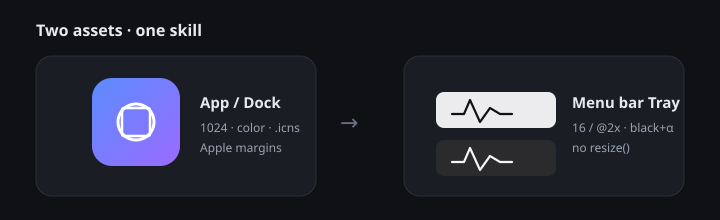

<p align="center">
  
</p>

<h1 align="center">mac-app-icon-tray</h1>

<p align="center">
  <strong>macOS App / Dock 图标 + 菜单栏 Tray（template image）</strong><br/>
  面向 Electron 与原生 AppKit / SwiftUI 的可复用 Agent Skill
</p>

<p align="center">
  <a href="https://github.com/Levelup-JC/mac-app-icon-tray/releases/tag/v1.0.0"></a>
  <a href="LICENSE"></a>
  
  
</p>

---

## 为什么需要这个 skill

菜单栏图标发糊、浅色看不见、Dock 显示默认齿轮——常见原因几乎都一样：

| 现象 | 根因 |
|------|------|
| Retina 发糊 | 对 Tray 调了 `resize()`，或缺少 `@2x` |
| 实心灰块 | 背景不透明 / 不是 template |
| 深浅色下消失 | 用了灰色或彩色笔画 |
| Dock 不对 | 只有 `dock.setIcon()`，没有 `.icns` |

本 skill 把 **硬规则、导出规格、Electron / AppKit 接入、文件级 + 真机验收** 收成一份可执行流程，避免每次从零踩坑。

## 范围

| 做 | 不做 |
|----|------|
| App / Dock 图标（1024 母版 → `.icns`） | 应用内 UI、窗口外观、配色系统 |
| 菜单栏 Tray（SVG → `trayTemplate` 1x/2x） | Windows / Linux 托盘（规则不同） |
| 加载代码与验收命令 | 交互流程、快捷键、产品功能 |

## 硬规则（摘要）

1. **两套资产独立**：彩色 App ≠ 单色 Tray；禁止把带底板的 App 图标缩小当 Tray。
2. **Tray 像素**：仅 `#000000` + alpha；背景 alpha = 0。
3. **命名固定**：`trayTemplate.png`（高 16）+ `trayTemplate@2x.png`（高 32）。
4. **禁止 `resize()`**：按文件名加载，让系统选 `@2x`。
5. **App**：1024 母版 + Apple 图标边距网格 + 打包 `.icns`。

完整条文、步骤、代码片段与检查清单见 **[SKILL.md](./SKILL.md)**。

## 快速开始

```bash
# 1. 克隆
git clone https://github.com/Levelup-JC/mac-app-icon-tray.git

# 2. 把 SKILL.md 装进你的 agent skills / workflows 目录
#    （路径因平台而异：Cursor skills、Grok Bot workflows 等）

# 3. 触发词示例
#    「给这个 Mac 应用做 Dock 和菜单栏图标」
#    「Tray 发糊了，按 mac-app-icon-tray 验收」
```

### Electron（Tray 最小正确写法）

```js
const { Tray, nativeImage } = require('electron')
const path = require('path')

let tray // 强引用，防止被 GC

const img = nativeImage.createFromPath(
  path.join(__dirname, 'assets', 'trayTemplate.png')
)
img.setTemplateImage(true) // 双保险；文件名含 Template 时 Electron 也会识别
tray = new Tray(img)
// 不要 img.resize(...)
```

### 文件级验收

```bash
sips -g pixelWidth -g pixelHeight -g hasAlpha \
  trayTemplate.png trayTemplate@2x.png icon-1024.png

iconutil -c iconset icon.icns -o /tmp/check.iconset && ls /tmp/check.iconset
# 期望：16–512 的 1x 与 @2x，共 10 张
```

## 仓库结构

```
mac-app-icon-tray/
├── SKILL.md              # Agent 可执行全文（frontmatter + 硬规则/步骤/验收）
├── README.md             # 本页
├── LICENSE               # MIT
└── docs/
    └── app-vs-tray.svg   # 封面示意
```

## 版本

| 版本 | 说明 |
|------|------|
| [v1.0.0](https://github.com/Levelup-JC/mac-app-icon-tray/releases/tag/v1.0.0) | 初版：修正 Tray resize / 纯黑+alpha / 命名 / 1024·icns / NSStatusItem / 验收命令 |

## 贡献与反馈

Issue / PR 欢迎。改硬规则前请先对齐 [SKILL.md](./SKILL.md) 里的检查清单，并附上浅色 / 深色菜单栏截图。

## License

[MIT](./LICENSE) © Levelup-JC
